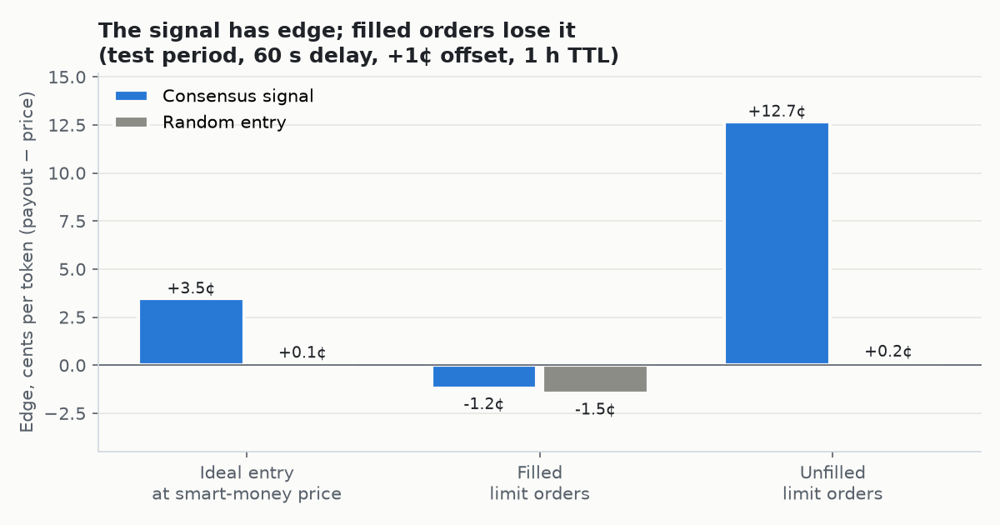

# Polymarket smart-money research

Do "smart money" wallets on Polymarket have real, persistent skill, and can you make money by following them? This repo is the full research: data pipeline, walk-forward wallet scoring, a backtest with a strict fill model, a comparison against Pinnacle odds for esports, and a paper-trading bot that tests the one idea the backtest couldn't settle.

**Data and paper trading only. No live orders, no wallet, no private keys.**

## TL;DR

- **Skill is real and persists out of sample.** Top-50 wallets by walk-forward score earned **+5.9%** ROI on their trades in the following month, against **+1.1%** for everyone else, and were positive in 12 of 12 full months.
- **Consensus carries information.** When 2+ top wallets enter the same outcome, the market resolves **+3.5¢ per token** above their entry price, on both train and test. A random entry gets about 0.
- **You can't capture it with passive limit orders.** Orders fill mostly when the market moves against the signal: filled orders have **−1.2¢** edge, unfilled ones would have had **+12.7¢**. The more volume you can fill at your price, the worse it gets.
- **Parameter tuning doesn't transfer.** The best train configs (+50% to +206% ROI) mostly lose money on test. Only 18% of 3,000 configs with enough trades are positive on test.
- **Esports: Polymarket is as sharp as Pinnacle.** On 2,711 CS2, LoL and Dota 2 matches, the last pre-match price has a Brier score of **0.1990** on Polymarket vs **0.2010** for Pinnacle (no-vig). Betting on big price gaps loses: when the two disagree, Pinnacle is usually the one that's wrong.



The open question is aggressive (taker) entry, which needs historical order-book data that doesn't exist. So the paper-trading bot records the live order book going forward.

## Data

| | |
|---|---|
| Markets | 247,099 resolved binary markets (closing Jul 2025 – Oct 2026, volume ≥ $10k), plus 3,102 markets from the gap after the snapshot |
| Trades | 225.5M on-chain fills from the [`SII-WANGZJ/Polymarket_data`](https://huggingface.co/datasets/SII-WANGZJ/Polymarket_data) snapshot (2.9 GB Parquet), plus 7.6M trades through Nov 5, 2026 from the public Data API v2 |
| Wallets | 2.16M |
| Storage | One `trades` view in DuckDB: `ts, wallet, market_id, outcome, side, price, size_usd, …` |
| Checks | Positions across all sides sum to zero; prices in (0, 1); no gaps |
| Esports odds | Pinnacle series-winner odds via [OddsPapi](https://oddspapi.io), matched to 3,287 Polymarket markets |

The raw data (~12 GB) is not in the repo; the ingest scripts rebuild it from public sources.

## Method

1. **Walk-forward scoring** (`research/scoring/`). On the 1st of each month, wallets are ranked using only markets that resolved before that date (6-month window), so there is no look-ahead. Rank = lower confidence bound of mean edge per market. Market makers and hedgers are filtered out. Scored separately for 10 categories.
2. **Consensus signals** (`research/backtest/signals.py`). A signal fires when ≥ K top-N wallets enter the same outcome within W hours.
3. **Strict execution model** (`research/backtest/execution.py`). A limit order at the smart-money price + offset, placed after a delay. It counts as filled **only if later trades printed at that price or better** before it expired, and size is capped at 50% of that printed volume. 1% fee.
4. **Grid and out-of-sample split** (`research/backtest/sim.py`, `evaluate.py`). 7,560 configurations, selected on Oct 2025 – Apr 2026, tested on May – Sep 2026, always against a random-entry baseline at the same timestamps.

## Results

**Skill persistence**, next-month ROI on the wallets' own trades:

| | top-10 | top-25 | top-50 | top-100 | everyone else |
|---|---|---|---|---|---|
| all categories | **+17.3%** | +7.1% | +5.9% | +3.3% | +1.1% |
| politics | +7.7% | +4.1% | +3.4% | +2.6% | +1.4% |
| weather | +4.9% | +4.7% | +4.5% | +4.1% | +2.3% |
| esports | +0.4% | +2.7% | +3.5% | +3.0% | +1.3% |

**Train vs test**, best config per category on train:

| Category | Train ROI | Test ROI | Random entry, test |
|---|---|---|---|
| crypto (best overall) | +206% | −11.2% | −1.9% |
| all | +81% | −14.7% | +1.7% |
| sports | +59% | −0.2% | −3.7% |
| weather | +50% | −15.4% | −4.5% |
| culture | +12% | +16.7% | −2.8% |

Only politics and culture stay positive out of sample, on small samples. That makes them hypotheses, not strategies.

**An esports platform quirk.** Almost all esports markets (30,678 of 30,681) have `clearBookOnStart`: the order book is wiped when the match starts, so pre-match limit orders can't fill after kickoff. The backtest drops those fills. 75% of esports consensus signals arrive during the match, and those lose the most.

## Paper-trading bot (`paper/`)

A stdlib-only Python bot that trades on paper with the rule frozen from the backtest:

- **Signal:** ≥ 2 top-50 esports wallets enter the same outcome within 6 h, before the match starts.
- **Order:** a virtual limit at smart-money price + 1¢, placed 60 s later, alive 5 min, and it must expire before kickoff.
- **Fill:** counts only if the public tape printed at our price within those 5 min. Stake = min($100, 50% of that volume).
- **Taker experiment:** the bot also records the order book at placement, to measure what an immediate buy of up to $100 would have got.
- **Stale data:** signals detected more than 15 min late (restart, API lag) are recorded but not traded. The report warns when the monthly wallet list is out of date.

It uses public APIs only (Gamma, Data API v2, CLOB `/book`), stores everything in SQLite, and writes a self-refreshing `report.html`. A macOS LaunchAgent template is included (`paper/com.polymarket-research.paper.plist`; set your own paths).

```bash
cd paper && python3 bot.py        # runs the loop; open report.html in a browser
```

## Layout

```
research/
  ingest/     download, clean and unify data (HF Parquet, Gamma, Data API v2, OddsPapi)
  scoring/    walk-forward wallet scoring and out-of-sample persistence
  backtest/   signals, execution model, portfolio sim, esports and Pinnacle studies
  reports/    stage reports, CSV results, charts
paper/        paper-trading bot and report generator
```

Python 3, DuckDB, Polars, NumPy, matplotlib. The OddsPapi key goes in `.env` (see `.env.example`).

## Reports

Detailed stage reports are in Russian: [`summary.md`](research/reports/summary.md), [data](research/reports/stage1_data.md), [scoring](research/reports/stage2_scoring.md), [backtest](research/reports/stage3_backtest.md), [esports](research/reports/esports.md), [Pinnacle](research/reports/pinnacle.md). The CSV files next to them hold every number.

Built by [Denis Bobrik](https://www.linkedin.com/in/denis-bobrik/) with Claude Code as the main development tool.
