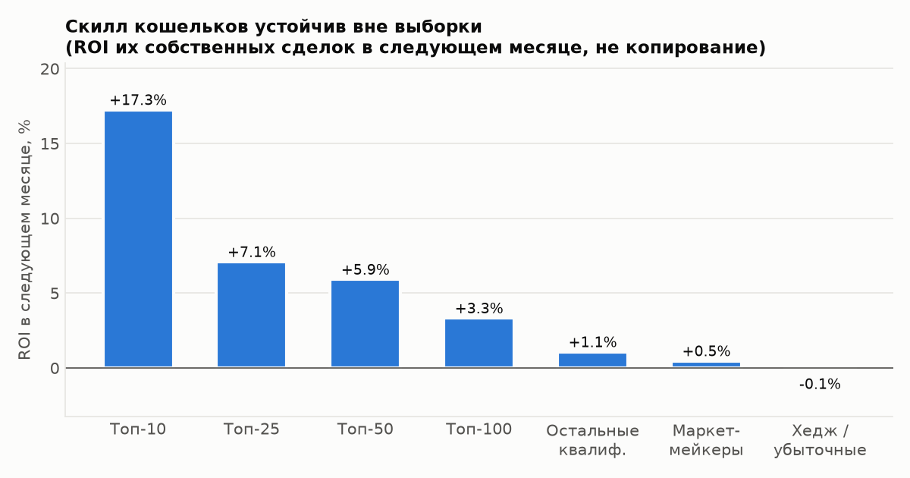
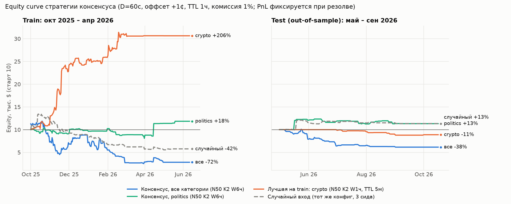
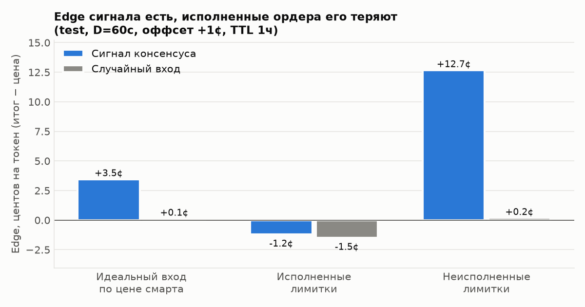
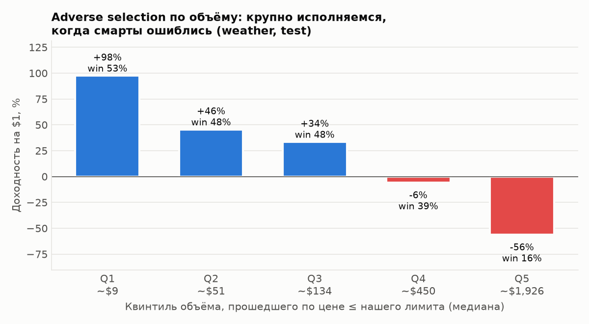
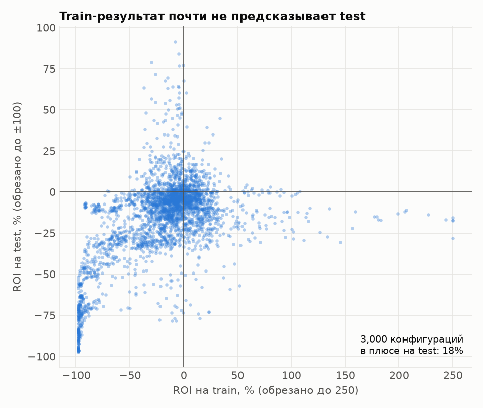

# Копитрейдинг Polymarket по консенсусу «умных» кошельков — итоговый отчёт

*Только данные и бэктест: никакой живой торговли, никаких ключей. Данные: on-chain сделки CLOB до 2026-10-04 (HF `SII-WANGZJ/Polymarket_data`), добор до 2026-11-05 через Gamma и Data API v2.*

## TL;DR — честный вывод

**Устойчивого edge после издержек у стратегии нет.** При этом её исходная гипотеза наполовину верна:

1. **«Умные» кошельки существуют, и их скилл устойчив вне выборки.** Топ-50 по walk-forward скорингу дают +5.9% ROI на своих сделках в следующем месяце против +1.1% у остальных и были в плюсе в 12 из 12 полных месяцев.
2. **Консенсус несёт информацию.** Когда ≥2 топ-кошелька входят в один исход, итог резолва в среднем на **+3.5¢ на токен** выше их цены входа, стабильно на train и test. У случайного входа это ~0.
3. **Скопировать этот edge пассивной лимиткой нельзя.** Ордер исполняется в основном тогда, когда рынок идёт против смартов: у исполненных edge **−1.2¢**, у неисполненных было бы **+12.7¢**. Чем больше объём, который можно набрать по нашей цене, тем хуже: при ~$1 900 доходность −56%, при ~$9 — +98%.
4. Подбор параметров на train не переносится на test. Лучшие конфигурации с train ROI от +50% до +200% на test в основном убыточны. В плюсе на test 18% из 3 000 конфигураций с достаточным числом сделок.
5. Единственные ниши с плюсом вне выборки — **politics** и **culture**. Выборка маленькая (десятки–сотни сделок), а проверено 7.5 тыс. конфигураций, так что это гипотеза для paper-trading, а не стратегия.

**Что не проверено и может изменить вывод:** агрессивный вход по стакану (taker), то есть «купить сразу по аску до ref + X». Без исторических данных стакана его не смоделировать честно. Наша модель требует, чтобы кто-то другой наторговал по нашей цене, и для правых сигналов это систематически пессимистично. Следующий шаг — записывать стакан CLOB вперёд и вести paper-trading.

---

## 1. Данные (Этап 1 → [stage1_data.md](stage1_data.md))
| | |
|---|---|
| Рынки | 247 099 резолвнутых бинарных рынков (закрытие 2025-07-01 … 2026-10-04, объём ≥ $10k, срок жизни ≥ 6 ч, без внутридневной крипты `updown-5m/15m`) + 3 102 рынка из «дыры» (≥ $100k) |
| Категории | теги Gamma → sports 129k · esports 31k · crypto 27k · weather 27k · politics 10k · finance 8.6k · geopolitics 6.8k · culture 4.6k · tech 2.1k |
| Сделки | 225.5 млн исполнений из HF (2.9 ГБ Parquet) + 7.6 млн сторон через Data API v2 (2026-10-05 … 11-05) |
| Кошельки | 2.16 млн |
| Единая таблица | view `trades` в `data/polymarket.duckdb`: `ts, wallet, market_id, outcome, side, price, size_usd, tx_hash, …` + `yes_qty` (покупка NO ≡ продажа YES) |
| Проверки | Σ позиций по всем сторонам = 0; цены в (0,1); пропусков нет |

`tx_hash` для HF-данных не хранится: на диск бы не поместилось. Ключ — `(block, log_index)`.

## 2. Скоринг кошельков (Этап 2 → [stage2_scoring.md](stage2_scoring.md))
- **Walk-forward:** на каждое 1-е число месяца используются только рынки, резолвнутые раньше (окно 6 мес.). Утечки будущего нет.
- **Метрики:** realized PnL, ROI, число закрытых рынков, win rate, **edge = (итог резолва − цена входа) по направлению сделки**. Ранг = нижняя граница доверительного интервала среднего edge на рынок.
- **Фильтры:**
  - ≥ 100 закрытых рынков;
  - маркетмейкеры исключены: двусторонние, maker-доля ≥ 70% или ≥ 10 сделок/рынок при средней сделке < $50;
  - хедж/арбитраж помечен (|edge| < 0.5¢ при обороте ≥ $100k);
  - оборот ≥ $5k.
- **Раздельный скоринг** по 10 категориям. Топ-200 на каждую дату и категорию — `data/processed/scores/top_wallets.parquet`.



| OOS-ROI в следующем месяце | top-10 | top-25 | top-50 | top-100 | остальные |
|---|---|---|---|---|---|
| все категории | **+17.3%** | +7.1% | +5.9% | +3.3% | +1.1% |
| weather | +4.9% | +4.7% | +4.5% | +4.1% | +2.3% |
| politics | +7.7% | +4.1% | +3.4% | +2.6% | +1.4% |
| sports | +7.7% | +3.0% | +0.7% | +0.5% | +1.0% |
| esports | +0.4% | +2.7% | +3.5% | +3.0% | +1.3% |

## 3. Бэктест консенсуса (Этап 3 → [stage3_backtest.md](stage3_backtest.md))

**Сигнал:** ≥K кошельков из топ-N (ранг на начало месяца) **вошли** в один исход за W часов. Входы отделены от выходов по накопленной позиции.

**Ограничения на рынок:** закрытие в течение 30 дней после сигнала (правило известно заранее), цена сигнала в [0.02, 0.95].

**Исполнение:**
- лимитка = цена последнего входа смарта + оффсет, через D секунд;
- пропуск, если цена уже выше ref + 5¢;
- исполнение засчитывается, **только если позже прошла сделка по нашей цене или лучше** в пределах TTL; цена = наша лимитная;
- размер ≤ 50% объёма, прошедшего по этой цене;
- комиссия 1% от суммы входа.

**Портфель:**
- $10k, 2% equity на сделку;
- ≤ 2% на рынок, ≤ 25% на категорию.

**Сетка** (7 560 конфигураций): K ∈ {2,3,4}, W ∈ {1,6,24} ч, D ∈ {5 с, 60 с, 5 мин}, оффсет ∈ {0, 1, 2}¢, TTL ∈ {5 мин, 1 ч, 6 ч}, топ-N ∈ {10,25,50}, категория ∈ {all + 9}.

**OOS:** подбор на сигналах окт 2025 – апр 2026, проверка на май – 4 сен 2026.

### 3.1 Equity curves


Конфигурации на графике (комиссия 1%):

| Конфигурация | Train ROI | Test ROI |
|---|---|---|
| Консенсус, все категории — фиксированная «средняя» конфигурация (N50 K2 W6ч, D60, +1¢, TTL1ч) | −72% | −38% |
| Консенсус, politics, та же конфигурация | +18% | **+13%** |
| Лучшая на train (crypto N50 K2 W1ч, D60, 0¢, TTL 5м) | **+206%** | −11% |
| Случайный вход, та же «средняя» конфигурация (3 сида) | −42% | +13% |

PnL фиксируется в момент резолва, поэтому кривые ступенчатые. Max drawdown выбранных конфигураций на test: от −2% до −20% (см. `stage3_selected_configs.csv`).

### 3.2 Где теряется edge: adverse selection


| Test, D=60 с, +1¢, TTL 1 ч | Сигналов | Edge по цене смарта | Fill rate | Edge исполненных | Edge неисполненных |
|---|---|---|---|---|---|
| консенсус | 6 375 | **+3.5¢** | 75% | **−1.2¢** | +12.7¢ |
| случайный вход | 14 888 | +0.1¢ | 67% | −1.5¢ | +0.2¢ |



Набрать полный размер удаётся почти только тогда, когда цену пробивают насквозь, то есть когда смарты ошиблись. Поэтому расчёт «по $100 на сделку» для weather на test показывает +$13.4k, а с ограничением по фактически доступной ликвидности тот же набор даёт −$2.7k.

### 3.3 Подгонка и out-of-sample


- Spearman train→test: ROI 0.35, Sharpe 0.26. Большая часть связи держится на стабильно убыточных конфигурациях (esports, all, sports). Среди конфигураций, сильных на train, test в основном отрицательный.

| Лучшая на train в нише | Train ROI | Test ROI | Test сделок | Случайный вход, test |
|---|---|---|---|---|
| crypto (лучшая в целом) | +206% | **−11.2%** | 30 | −1.9% |
| all | +81% | −14.7% | 17 | +1.7% |
| politics | +83% | −4.2% | 3 | −3.0% |
| sports | +59% | −0.2% | 105 | −3.7% |
| weather | +50% | −15.4% | 15 | −4.5% |
| culture | +12% | +16.7% | 30 | −2.8% |
| geopolitics | +12% | +13.3% | 9 | −2.3% |
| **1 лучший кошелёк** (weather) | +6.8% | −4.0% | 13 | −0.3% |

**Устойчивость по всей сетке** (все конфигурации с ≥ 10 сделками в обоих периодах):

| Ниша | Конфигураций | В плюсе на test | Медианный test ROI |
|---|---|---|---|
| culture | 311 | 45% | −2.6% |
| geopolitics | 348 | 38% | −3.1% |
| tech | 399 | 31% | −4.6% |
| crypto | 370 | 29% | −1.5% |
| politics | 282 | 18% | −6.2% |
| weather | 388 | 12% | −12.8% |
| sports | 216 | 2% | −24% |
| all | 200 | 0% | −21% |
| esports | 477 | 0% | −52% |

**PnL по нишам** при фиксированной «средней» конфигурации и ставке ≤ $100, ограниченной ликвидностью (`stage3_sizing_sensitivity.csv`):

| Ниша | Train | Test |
|---|---|---|
| politics | +$1 107 | **+$671** |
| culture | −$72 | **+$3 189** |
| crypto | +$4 157 | −$2 024 |
| weather | +$2 905 | −$2 721 |
| sports | −$2 636 | −$676 |
| esports | −$25 449 | −$10 896 |
| all | −$4 073 | −$2 033 |

### 3.4 Бейзлайны и комиссии
- **Копировать одного лучшего кошелька** хуже консенсуса: медианный ROI отрицательный почти во всех нишах.
- **Случайный вход** с той же механикой исполнения: −2…−4% на выбранных конфигурациях. Это цена adverse selection и комиссий без информации. На «средней» конфигурации консенсус по всем категориям проигрывает случайному входу: −38% против +13% на test. Консенсус чаще попадает в рынки с резкими движениями, где исполнение особенно токсично.
- **Комиссии** при этом сайзинге почти не важны: test ROI при 0 и при 200 bps различается на десятые доли процента. Проблема — в составе исполненных сделок.

### 3.5 Киберспорт: до матча и во время матча → [esports.md](esports.md)
- **75% сигналов приходят во время матча.** Все 504 конфигурации в этой части убыточны на test, медиана −48%. У исполненных ордеров edge −5.8¢, у неисполненных +23¢: смарты реагируют на игру быстрее, чем их можно скопировать.
- **До матча** (с учётом того, что Polymarket очищает стакан на старте) медиана около 0%. Устойчив только узкий вариант: топ-50, ≥ 2 кошелька, лимитка на 5 минут. Он даёт ≈ +6% на оборот, 8 месяцев в плюсе из 11, +$2.4k при ставках ≤ $100. Это кандидат для paper-trading, а не доказанный edge.

## 4. Ограничения
- **Нет стакана.** Модель исполнения консервативна для пассивных ордеров и пессимистична для агрессивных. Доля доступной ликвидности 50% — допущение; при 25 / 50 / 100% знаки результатов по нишам те же, кроме weather на test (−$5.3k / −$2.7k / −$0.1k).
- Test — 4 месяца; во многих нишах < 30 сделок. Проверено 7.5k конфигураций, поэтому положительные результаты на малых выборках ожидаемы и по случайности.
- Время резолва = `end_date` рынка: фактическая выплата бывает позже, связывание капитала занижено.
- Комиссия — фиксированные bps, а не точная fee-схема Polymarket по типам рынков.
- Вселенная рынков отфильтрована по финальному объёму ≥ $10k — небольшой look-ahead в выборе рынков (не в сигналах и метриках кошельков).
- Edge кошелька в скоринге считается по всем сделкам, включая выходы. В сигналах учитываются только входы.

## 5. Что делать дальше
1. **Paper-trading на politics и culture**: фиксированная «средняя» конфигурация, без дальнейшего подбора параметров. Нужно ≥ 200 сигналов, чтобы отличить edge от шума.
2. **Записывать стакан CLOB** (`/book` по рынкам с сигналами) в реальном времени. Это единственный способ честно проверить агрессивный вход: исполнится ли taker-ордер по ref + 1–2¢ сразу после сигнала, и каков edge у таких входов.
3. Не тратить время на sports, «все категории» и киберспорт во время матча: там стратегия стабильно хуже случайного входа. Киберспорт до матча (топ-50, K = 2, лимитка на 5 мин) стоит добавить в paper-trading.

## Воспроизведение
```bash
.venv/bin/python -I ingest/fetch_trades.py          # HF trades -> data/processed/fills (через CDN, помесячно)
.venv/bin/python -I ingest/gamma_tags.py            # категории событий
.venv/bin/python -I ingest/data_api_gap.py 100000   # добор 2026-10-05 → сегодня
.venv/bin/python -I ingest/build_db.py              # data/polymarket.duckdb (markets, fills, api_trades, view trades)
.venv/bin/python -I scoring/wallet_market.py && .venv/bin/python -I scoring/score.py && .venv/bin/python -I scoring/persistence.py
.venv/bin/python -I backtest/entries.py && .venv/bin/python -I backtest/signals.py && .venv/bin/python -I backtest/execution.py
.venv/bin/python -I backtest/sim.py 100 && .venv/bin/python -I backtest/evaluate.py
.venv/bin/python -I reports/make_charts.py
```
